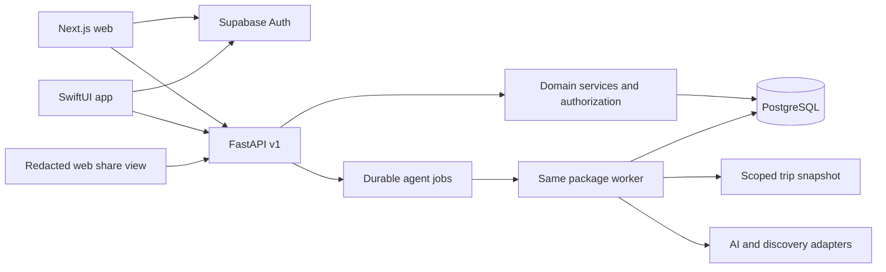

# Wonder architecture

Status: proposed implementation baseline, October 11, 2026. No services are deployed by this document. Owner decisions: Magic first in Barcelona; private-beta first release; equally complete core web/native iOS. The same-day SpeedHacks demo is separately scoped in [HACKATHON_INTEGRATIONS.md](docs/HACKATHON_INTEGRATIONS.md). The product brief is preserved in [PRODUCT_BRIEF.md](docs/product/PRODUCT_BRIEF.md). Domain records and wire behavior are defined in [DATA_MODEL.md](docs/DATA_MODEL.md) and [CONTRACTS.md](docs/api/CONTRACTS.md).

## Decisions and trade-offs

| Decision | Why | Cost / alternative |
|---|---|---|
| Monorepo; separate web, Swift and Python packages | shared contracts and atomic reviews for five developers | three toolchains; avoid trying to share UI code across Swift and React |
| Next.js App Router, TypeScript strict, Tailwind/shadcn | responsive web and accessible component foundation | React complexity; do not add independent business rules in server actions |
| SwiftUI native app | supports native share flows and later extensions | more work than a web wrapper; Magic beta requires web/native core parity; connected-trip scope is staged |
| FastAPI modular monolith | one authorization/context service and Python AI tooling | separate hosting from web; defer microservices and LangGraph |
| Supabase PostgreSQL and Auth | managed identity and relational integrity | vendor boundary behind auth verifier/repositories; migrations remain portable SQL |
| Backend-only trip data access | one permission and transaction policy for all clients | extra API hop; revoke public Data API access to domain tables |
| Versioned REST and OpenAPI 3.1 | deterministic generated TypeScript/Swift clients | generated clients require review; no hand-maintained mirror schemas |
| Durable Postgres job table and one worker | restart-safe agent runs without Redis infrastructure | leases/retries need tests; swap queue adapter if throughput warrants it |
| Polling in MVP, realtime later | fewer authorization paths and predictable recovery | updates are not instant; clients refetch on foreground/save |
| External booking/navigation links only | useful actions without transactional provider complexity | no claim of reservation or conversion until independently confirmed |
| Equal/custom splits, one currency per trip | deterministic first ledger | percentage/weighted splits and FX deferred behind explicit change request |

Web deployment target: Vercel; API/worker target: one managed container platform (proposed Render); database/Auth target: Supabase. These are architecture choices, not account provisioning or approved spending. Select region, plan, quotas and deployment owner before beta. Keep API and database near each other; confirm hosting limits support worker leases and database connections. Start without Realtime, Storage uploads, Redis, vector search or merchant service.

## Runtime boundaries

Next.js may proxy authenticated API requests to simplify cookies and CORS, but contains no second domain backend. Swift uses bearer access tokens stored through the auth SDK/Keychain. The iMessage target receives only redacted share content and URLs, not conversations or group membership authority. Widget uses an app-group redacted snapshot with an `updated_at` label, never a promised live feed.

A backend module owns its routes, domain logic, tests and repository interface. Shared core owns transactions, request identity, authorization helpers, trip-context construction and job infrastructure. Modules call public service interfaces; they do not import another module's internal SQL/model mutation code. Agents cannot write trips, expenses or bookings directly. All clients use the same contract and source of truth.

## Authentication and authorization

Verify Supabase JWT signatures with maintained libraries and configured issuer, expiry, audience, allowed algorithms and key rotation. Use asymmetric signing keys/JWKS for the planned deployment; do not merely decode tokens. Load current active membership from the database on every trip operation, rather than trusting editable user metadata or stale role claims. Review current auth docs again during implementation.

Domain tables live in a non-exposed `app` schema. Revoke `anon`/`authenticated` direct domain-table grants. API DB role has only needed privileges, has no BYPASSRLS, and is distinct from migrations/admin. Enable and force RLS on both user-owned and trip-owned tables as defense in depth; API transactions set a transaction-local verified user identity used by policies. Worker uses a separate restricted role and rechecks the initiating user/membership before reading a snapshot, executing and applying results. Background housekeeping uses explicitly limited policies; never use an unrestricted service-role key as the general API connection.

RLS is additional protection, not the complete domain permission matrix. Authorization tests use the real runtime role, and prove cross-trip IDs cannot be combined through nested routes, foreign keys or jobs. Trip creation bootstraps its organizer membership in the same transaction using a narrowly specified creation policy; Phase 0 must test this bootstrap before exposing create-trip. Avoid broad SECURITY DEFINER helpers to bypass broken policies.

Organizer manages trip, invitations, roles and deletion; editor manages shared content and all ledger records; participant can read accessible shared content, complete assigned checklist/packing items, and create/manage their own expenses; viewer reads a sanitized itinerary/checklist view only. Viewer has no ledger access. All financial reads are scoped to involved participants unless organizer/editor. Guest representation has no privileges until invite exchange issues a restricted, expiring guest session. Guests initially get viewer scope only. Account claiming upgrades only the specific invited participant, once, transactionally.

Participation in a segment/activity means attendance, not automatic permission to view private data. Sensitive personal packing/constraints remain owner-visible unless explicitly shared. No passport numbers, children's names/precise ages, health records or document uploads are collected for MVP. Public shares use allowlisted snapshots with explicit opt-in; never serialize a full Trip object.

## Consistency, context and jobs

Each mutable record has integer `version`. Trip aggregate `context_version` increments transactionally whenever planning context, shared tasks, itinerary, packing, membership or relevant commitments change. ETag/If-Match prevents lost updates. A successful mutation writes domain change, audit metadata and invalidation together. No client optimistic update becomes authoritative until acknowledged.

Agents use an immutable `TripContext` snapshot assembled after authorization: dates/segments, minimal traveler configuration, effective preferences (request > trip > user defaults), relevant tasks and itinerary, commitments and budget. Exclude participant emails, guest tokens, private expenses and sensitive constraints that are unnecessary for the run. `trip_id=null` single-feature runs use explicit request context and user defaults, do not create phantom trips, and cannot later be applied to a trip without a fresh run.

A run records actor, agent, context version, request hash, status, expiry and structured proposal. API creates it and its durable job in one transaction, returning 202. Worker claims a lease, heartbeats, retries only transient failures (at most 3 attempts total with exponential backoff/jitter), and marks timed-out work failed after a configurable deadline (initial 120 seconds). Duplicate deliveries are safe; one successful proposal per run. Stop on permission revocation, cancellation or invalid output. Do not retry validation/auth/unsupported-region errors.

Applying a proposal is a separate authorized transaction. Check proposal expiry, actor visibility, membership, selected proposal item IDs and original context version; return 409 if the context changed. Insert accepted records with deterministic proposal-item references and uniqueness constraints. A replay returns the original result. Existing items are not deleted by an AI apply operation; replacing/reordering existing plans requires explicit user edits. No background agent mutates an itinerary silently.

## Magic and provider boundaries

`PlacesProvider`, `RouteProvider`, `WeatherProvider`, `EventProvider`, `ModelProvider` expose typed inputs and normalized outcomes: success, partial, unavailable, unsupported, rate_limited. Normalized records contain provenance, observed time, expiration, cost certainty, availability certainty, allowed actions and license/cache limitations. Fixture implementation exists only in future demo tooling and is never promoted to verified data. UI always displays fixture/estimate/unverified states.

Proposed first live adapters: Google Places + Routes for POIs/travel-time; one separately approved weather feed; event APIs optional after access is verified. Sponsor adapters add Darwin capability discovery, Keewano outcome-driven follow-up and explicitly confirmed Dial sharing; Alike is development coordination and Sparta is agent evaluation, not production trip storage. The [integration plan](docs/HACKATHON_INTEGRATIONS.md) defines contracts and enablement gates. Map rendering is client-specific, but **server routing** supplies feasibility so web and iOS do not disagree. Google-derived content must satisfy provider attribution, retention, caching and map-display rules; the provider adapter controls storage rather than copying entire place responses into permanent tables. No unsupported scraping of Luma/Meetup/Partiful, flight or hotel platforms.

Determine feasibility in deterministic code before AI ranking. Available window ends at the earlier of requested deadline or next relevant commitment minus its travel/buffer needs. Candidate must fit outbound travel + activity + onward travel + buffer. Preserve destination timezone, opening-hour intervals and event bounds. Initial buffer 15 minutes is an editable explicit input, not a travel guarantee. Return at most five candidates. Unknown route/hours yields `unknown`, never `feasible`; unknown candidates may appear separately if the user chooses estimates. With a budget, unknown price also excludes a candidate from the primary list; show it only in an explicitly uncertain section. Candidate validity is at most 15 minutes and never beyond source expiry/event bounds. Revalidate stale candidates before a save and explain changed assumptions. AI may explain/rank eligible results, never fabricate times, prices, venues or availability.

## Recovery, privacy and reliability

AI/provider failure leaves trip editing, checklist, packing toggles and expense math operational. Essentials/recovery starts with editable sourced templates and manually entered disruption tasks, not automatic flight monitoring or authoritative visa decisions. Important guidance includes jurisdiction, source URL, checked date and uncertainty. Templates explain how to check the responsible authority.

Beta iOS cache: selected trip summary, checklist and redacted itinerary only, read-only offline with visible timestamp. No offline writes, secrets, guest tokens in widgets, document scans or payment details. Wipe cached trip data on logout or revoked access. Durable manual bookings record user-provided confirmation status/source; an outbound link never creates confirmation.

Initial retention targets (product-owner review before beta): guest tokens 7 days; shares 7 days; unaccepted proposals 24 hours; exact single-feature location deleted after run expiry (max 24 hours); operational logs 14 days; synthetic demo data reset between demos. Account/trip deletion must remove application records and revoke shares/sessions; backups expire under a documented provider schedule. Do not promise instant backup erasure. Export/deletion and tested restore procedure are beta gates.

Structured logs use request/run IDs, status, latency, adapter, token counts and error class; redact prompts, tokens, precise locations and user text. Proposed Sentry/PostHog integrations remain opt-in until redaction/consent are implemented. D1 owns per-user AI limits, provider quotas, concurrency caps and kill switches. Initial targets, subject to load tests: non-AI API p95 < 500 ms in-region, agent p90 < 30 seconds excluding provider incidents. Record run cost and accepted-action cost; monthly budget needs owner input.

## Delivery and evolution

Separate local, staging and production projects/keys. PR previews use synthetic data. Versioned migrations are append-only after merge; expand-contract changes allow older mobile clients to run during rollout. Connection limits/pooler mode and transaction-local RLS identity must be verified together. Backup/restore, key rotation, worker-restart recovery, alert ownership and rollback are tested before beta. Widget/iMessage lifecycle limitations are tested on devices before claims of production support.

Phase 0 will turn the prose contracts into checked OpenAPI/Pydantic, generated Swift/TypeScript clients and representative fixtures before feature implementation. These specs are the reviewable boundary today, not a running API.

## Official references checked for this proposal

- [FastAPI features / OpenAPI](https://fastapi.tiangolo.com/features/)
- [Next.js installation](https://nextjs.org/docs/app/getting-started/installation)
- [Supabase JWT verification](https://supabase.com/docs/guides/auth/jwts)
- [Supabase RLS](https://supabase.com/docs/guides/database/postgres/row-level-security)
- [Supabase changelog](https://supabase.com/changelog): reviewed the HTML index because the Markdown endpoint could not be fetched; recheck applicable changes when pinning versions.
- [Google Places policies](https://developers.google.com/maps/documentation/places/web-service/policies)
- [Apple Messages framework](https://developer.apple.com/documentation/messages)
- [Widget update behavior](https://developer.apple.com/documentation/widgetkit/keeping-a-widget-up-to-date)

These references establish supported boundaries, not a claim that credentials, commercial rights or costs are already agreed.
