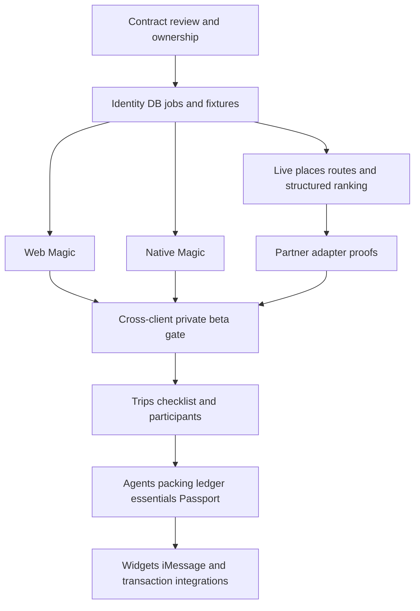

# Wonder execution plan

Planning only. Product name **Wonder**; repository `jayasrisng/super-travel`. The preserved Super Travel brief remains the product source of truth, updated by these explicit owner decisions on October 11, 2026: Magic first, Barcelona launch area, private beta as the first usable release, equally complete core web/native iOS, and deterministic backend work redistributed to D3. The hackathon demo is a separate milestone, not evidence that beta gates have passed.

## Repository assessment

Inspected remote through a clone and local history: `79dc17a` (October 11, 12:56 PDT), original `0751e2a` (12:42 PDT). Existing files were README and `docs/TEAM_BUILD_BRIEF.md` only. No runtime, CI, deployed providers, schema, Apple project or inherited AGENTS instructions existed. The team brief correctly identified five roles and trip isolation but left API, access, expense and provider semantics unresolved. Its five-day prototype schedule is replaced by the actual event schedule plus gated beta phases. No feature implementation is included here.

## Two delivery tracks

**Hackathon, October 11:** demonstrate one Barcelona Magic workflow and meaningful partner use with honest fixture disclosure. The official deadline is 5 PM PDT; start submission preparation at 4 PM. The event expects new work built during event hours. Existing commit dates show same-day documentation, but do not establish eligibility for all team assets; retain work provenance and ask organizers about any pre-existing code/assets. This is an event rule, not a requirement to stop documentation work. See [hackathon integration plan](docs/HACKATHON_INTEGRATIONS.md).

**Private beta:** release only when web and native iOS complete the same Magic core: sign in, area/time/preferences, live supported discovery, deterministic feasibility, provenance, save/navigation, empty/failure handling, history/preferences controls and privacy. Trip tools follow. Do not advertise the full original MVP as shipped at this gate.

## Phase 0 — contract and foundation readiness (P0)

Dependency: this planning review; owner D1 with affected owners. Estimate 0.5–1.5 team days for the beta foundation, not a hackathon promise. The event may use a reduced contract pack covering Magic only, but cannot skip authorization or provenance.

Deliverables:

1. Review API/data contracts and ownership matrix; resolve beta launch boundary polygon, model/provider access, budget and retention. Record owner answers in decisions. Register Apple bundle IDs and check signing/device distribution prerequisites (D5); no purchase required by this document.
2. Pin supported tool versions and commit lockfiles; scaffold empty package boundaries, health checks, lint/format configs, exact setup scripts and CI. Next.js/FastAPI scaffolding is allowed only in the subsequent implementation task, not this documentation change.
3. Implement checked OpenAPI 3.1 contract artifacts, generated TypeScript/Swift clients and fixtures for Magic, runs, saved experiences and identity. Include all staged operations as documented future contracts, without advertising unimplemented routes as usable. Tests prove clients decode valid/partial/error states and reject schema drift.
4. Establish Supabase local/staging projects, private schema, runtime/migration roles, JWT verifier, RLS policy tests, synthetic seeds and durable job leases. No production project or paid provisioning until budget/access are agreed.
5. Add provider-interface conformance fixtures, sanctioned adapter spike and per-provider key/cost checklist. D1 coordinates partner access; D2/D3 independently own assigned adapters after interface review.

Exit: clean checkout instructions work on a second developer machine; TypeScript/Swift decode the same fixtures; runtime DB role cannot cross user/trip boundaries; secrets are server-only; versioning/errors/replay are tested. Affected client owners acknowledge the contract review. Do not release a demo with fixtures hidden as live.

## Phase 1 — Magic vertical slice (P0)

Depends on Phase 0 minimal Magic contracts. D1 owns API/run/context and model; D4 web; D5 iOS; D2 communication/share adapter; D3 provider normalization/feasibility QA and event-feedback adapter. Estimate 2–4 team days for beta-quality slice, revised after first live provider spike.

Journey: authenticate → choose location in Barcelona → specify 90 minutes, interests and EUR budget → create run → poll → inspect ranked feasible results → save or navigate → see saved state on other client.

Use fixtures to develop independently, then one real POI + routing adapter before inviting beta users. The initial scope includes restaurants/cafes, cultural attractions and outdoor activities when source coverage supports them; events/workshops are separately gated. Return up to five feasible items and explicit empty/unknown states. User can supply a location without granting GPS access. Never claim paid entry under budget when price is unknown.

Exit: same inputs and server snapshot produce consistent feasibility on web/iOS; saved items survive restart; expired runs and retryable outages behave correctly; revocation cancels pending jobs; fixtures are obvious and disabled for tester live mode; Barcelona timezone/DST/opening-hours tests pass. A 90-minute test accounts for outbound/activity/onward/buffer rather than AI intuition.

## Phase 2 — meaningful integrations and beta hardening (P0/P1)

Depends on Phase 1. Parallel owner tasks use the adapters in the hackathon plan, with flags and tested fallback. Target all five partner proofs where access and time allow; beta does not depend on developer-only tooling. No speculative integration can delay the reliable main path indefinitely.

- D1: Darwin capability discovery and safe provider handoff; curated source fallback; quotas, request budget, tracing, worker recovery.
- D2: Dial explicit user-approved send of a selected, redacted Wonder result to a team-controlled/test recipient; verified status/webhook processing. Native share sheet continues to work without Dial. No automatic venue calls or purchases.
- D3: Keewano outcome-event ingestion and a query that changes follow-up suggestions, plus Sparta agent testing scenarios and evidence. Postgres remains authoritative; avoid creating a second mutable trip database.
- D4: live/fixture/unknown UI, keyboard/accessibility/mobile browser checks, measurable useful-action funnel.
- D5: native parity, sign-in/deep-link lifecycle, location-denied path, on-device integration, secure caches and release distribution.

Beta exit: live smoke tests, unknown data handling, rate limits, consent and deletion/export behavior, retention job, least-privilege role tests, end-to-end save/navigation, retry/replay, backup restore and documented rollback pass. Web and iOS meet the **same core criteria**; no prototype-only exemption. Record partner dependency failures and distinguish estimated time savings from observed timings.

## Phase 3 — connected trip foundation (P1)

Depends on Magic beta boundary being stable. D1 owns trip/segments/context; D3 checklist/packing persistence; D2 participants/invites/share; D4/D5 clients. Estimate 2–4 team days, subject to beta feedback.

Journey: create Tokyo family trip and overlapping friends trip → personalized deterministic checklist → task update reflected across clients → selected-segment guest invitation. Keep Barcelona Magic available standalone and optionally trip-scoped; unsupported Tokyo live discovery is explicit.

Exit: three traveler configurations produce meaningful template changes; removing membership immediately revokes access; segment dates validated; guest starts read-only; redacted share revokes correctly; private packing details excluded; no cross-trip resource access. Last organizer cannot be removed. No hidden enrollment or automated communication.

## Phase 4 — remaining required connected MVP (P1)

Depends on Phase 3; subtracks can overlap within contracts. Estimate 3–6 team days, not a fixed launch date.

- D1: Plan & Book and Pack & Shop structured proposals, third Explore agent via Magic, itinerary and manual booking evidence. Explicit acceptance and context-version conflict handling.
- D3: expenses/equal/custom splits, reviewed refunds/manual settlements; essentials/recovery templates, explicit completed experiences and basic Passport.
- D2: segment/activity attendance, share-link fallbacks and coordination components; iMessage extension only after host app is stable.
- D4/D5: full connected checklist, itinerary, packing, finance and Passport parity for selected MVP screens; focused feature entry without full-trip onboarding.

Exit: reproduce the original Tokyo/friends/expense/90-minute journey with supported live coverage or plainly disclosed destination fixtures; all three agents callable; rejected AI output cannot modify domain state; sum-to-zero balances and refund caps pass; no booking/payment claims from external clicks; visited places require explicit confirmation. Full brief MVP status is awarded only here, after all required capabilities are accepted.

## Phase 5 — staged expansion (P2)

Widgets/App Intents, native Messages extension, push, offline writes, full event aggregation, advanced splits/FX, flight disruption monitoring, document uploads, merchants, direct booking/payment and premium recaps each need an ADR, operational provider evidence, cost budget and new release gate. A supported API does not establish a commercial partnership. Widgets expose only redacted stale-aware summaries. No autopurchase or auto-cancellation.

## Dependency and integration order

Private beta gate requires production-ready **enabled** adapters; optional partner tooling that is unavailable is disclosed and disabled. Core Magic may fall back to approved curated discovery, but never to fabricated live results. No external action occurs merely because an agent returns an action object.

## Team execution and conflict prevention

Use the file ownership table in [team brief](docs/TEAM_BUILD_BRIEF.md). Shared files (OpenAPI, migration ordering, root manifests/workflows, Xcode project, token definitions) require a short reservation in the team channel, one editor at a time and a reviewed PR. This is coordination, not a blanket permission to send messages with tools. D1 serializes contracts/migrations; D5 alone edits Xcode project/entitlements; D2 adds source files in preassigned folders and submits target-change requests to D5.

Daily integration: each owner states dependency and contract blockers; merge one vertical slice at a time; regenerate both clients after a contract merge; use fixture-driven UI work during backend delays. Review is not implementation ownership: D1 must not become a mandatory editor for every domain file. Assign real GitHub handles/CODEOWNERS and a backup reviewer in Phase 0.

Definition of done: acceptance criterion demonstrated, meaningful tests passed, client/error/permission cases addressed, no secret leaks, environment inventory updated, docs/status truthful, migration strategy reviewed, PR reviewed by affected owner. Contract changes land before dependent features. Unresolved contract disputes use a documented decision with the smallest backward-compatible change.

## Risk register

| Risk | Trigger / mitigation | Owner |
|---|---|---|
| Same-day event vs beta scope | cut event demo to one journey; retain later beta gates | D1/product owner |
| Sponsor access not operational | time-box spikes; flag + curated fallback; never fake a successful provider run | adapter owner |
| Five workstreams collide | serialized shared-file changes, generated clients, folder ownership | all |
| AI invents feasibility/availability | deterministic filter and sourced values before ranking | D1/D3 |
| Barcelona data/license gaps | licensed sources, coverage polygon, unknown/empty UI | D1/D4 |
| Apple signing/distribution delays | validate signing/device path in Phase 0; no parity claim until verified | D5 |
| Costs unbounded | explicit ceiling, quota/kill switch; no paid provisioning yet | product owner/D1 |
| Money/guest privacy errors | DB constraints, role tests, explicit transactions | D2/D3 |
| Beta location leakage | no exact locations in telemetry/sponsor events; expiry and consent | all |

## Validation for this planning change

Validate relative document links, JSON examples, preserved brief equality, whitespace/diff cleanliness and consistency of name, release priorities, owners and endpoint enums. Do not claim application tests, runtime startup, provider credentials or deployments have been verified. Exact feature timelines depend on access, team experience and beta feedback; the event cutoff is the only fixed date.
