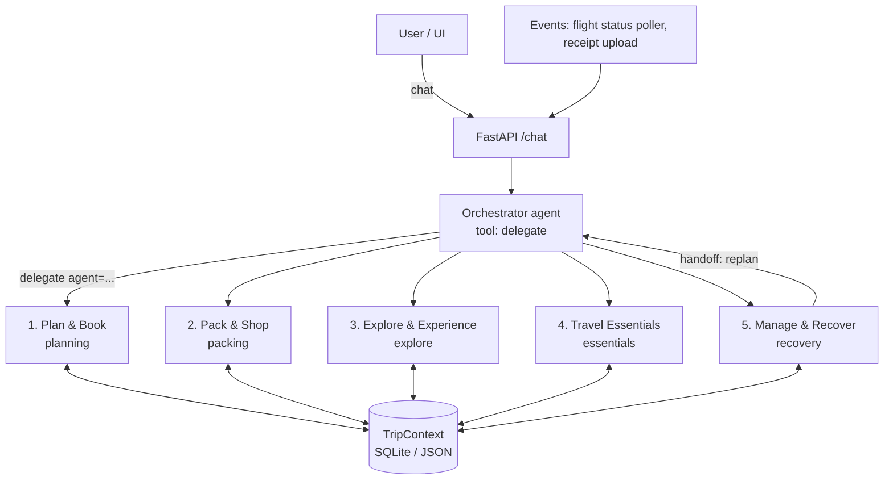

# super-travel: Agent Architecture

Implementation status: registry now includes all five names. The three requested proposal agents use the [local control API](CONTROL_API.md), not the planned /chat orchestrator below. Existing Essentials/Recovery tools retain prototype behavior; they are not exposed by the new control API.

Status: draft · Scope: hackathon/demo · Stack: Python (FastAPI) + Claude API

## 1. System shape

One **orchestrator** talks to the user and delegates to five **specialist agents**.
Specialists never call each other directly. If one needs another's help, it returns a
handoff and the orchestrator makes the next call. Everything shares one **TripContext**.



Why delegation through the orchestrator rather than a plain classifier: real requests cross
domains ("my flight got cancelled, will my eSIM still work for the extra day?"). With
delegation the orchestrator can call 5 and then 4 in one turn and merge the answers.

## 2. The contract every agent implements

The team has to agree on this part. The rest can be built separately.

```python
# core/agent.py
from dataclasses import dataclass, field
from typing import Protocol

@dataclass
class PendingAction:          # anything irreversible waits for a user "yes"
    kind: str                 # "rebook_flight", "send_claim_email", ...
    summary: str              # shown to the user as a confirm card
    payload: dict

@dataclass
class Handoff:
    to_agent: str             # "planning", "essentials", ...
    task: str

@dataclass
class AgentResult:
    reply: str                                  # text for the orchestrator to relay/merge
    pending_actions: list[PendingAction] = field(default_factory=list)
    handoffs: list[Handoff] = field(default_factory=list)
    data: dict = field(default_factory=dict)    # structured payload for UI cards

class Agent(Protocol):
    name: str            # "planning", "packing", "explore", "essentials", "recovery"
    description: str     # one paragraph; the orchestrator routes on this
    def run(self, task: str, trip: "TripContext") -> AgentResult: ...
```

Agents register in `agents/__init__.py: REGISTRY = {a.name: a for a in [...]}`. The
orchestrator has a single `delegate(agent, task)` tool whose `agent` enum is built from
`REGISTRY`. Adding an agent means adding it to the registry, with no orchestrator changes.

### TripContext (shared state)

```python
class TripContext(BaseModel):
    trip_id: str
    name: str
    status: str                        # planning | booked | in_progress | completed
    home: Location                     # city, country, timezone, currency
    travelers: list[Traveler]          # name, citizenship, residence, age band, dietary
    budget: Budget                     # total + currency (spent is derived from expenses)
    preferences: Preferences           # pace, interests, avoid, luggage, magic_discovery
    destinations: list[Destination]    # city, country, dates, tz, currency, language
    segments: list[Segment]            # flights/trains: carrier, number, PNR, times, bags
    stays: list[Stay]                  # check-in/out, cancellation policy
    reservations: list[Reservation]    # dining/attractions/experiences (agent 3)
    documents: list[Document]          # passports, visas, insurance policy
    expenses: list[Expense]            # amount, currency, category, payer, split, linked_to
    checklist: list[Task]              # owner_agent, due, status
    packing: Packing                   # lists + purchases (agent 2)
    incidents: list[Incident]          # disruptions/claims opened by agent 5
```

The canonical example is [`fixtures/demo_trip.json`](../fixtures/demo_trip.json). Scripted
demo events and sample prompts for each agent are in
[`fixtures/demo_events.json`](../fixtures/demo_events.json).

Rules: agents **read** the whole context and **write** only through their own tools. For
example, only agent 5 appends `incidents`, and agent 4 appends `checklist` items tagged
`owner="essentials"`.

## 3. Agent 4: Travel Essentials (prepare, proactive)

**Job:** turn the trip into a pre-departure briefing and checklist. This agent is mostly
read-only research. It is the lighter of the two and close to a workflow.

| Tool | Type | Source (demo) |
|---|---|---|
| `web_search` / `web_fetch` | Anthropic server tool | live: travel advisories, entry/visa rules, customs |
| `get_exchange_rate(from, to)` | client | frankfurter.app (free, no key) |
| `get_emergency_numbers(country)` | client | static JSON (police/ambulance/embassy) |
| `find_esim_plans(country, days)` | client | mock JSON |
| `get_health_requirements(country)` | client | web_search + static fallback |
| `add_checklist_items(items)` | client, writes TripContext | n/a |

Output: a structured `Briefing` (Pydantic, via `messages.parse`) with sections for payments
& currency, connectivity, health, insurance, safety, customs & etiquette, key phrases and
emergency contacts. The UI renders it as cards.

Triggers: when a trip is created, when a destination is added, or when the user asks ("do I
need a visa for Japan?").

## 4. Agent 5: Manage & Recover (react, plus post-trip)

**Job:** handle what goes wrong, then close out the trip. This agent takes actions, so it
carries the approval gates.

| Tool | Type | Notes |
|---|---|---|
| `get_flight_status(segment_id)` | client | mock: reads `live_status` set by app events; can be swapped for AviationStack later |
| `search_alternative_flights(from, to, date)` | client | mock JSON. Recovery finds options; planning books |
| `check_compensation(segment_id, event, delay, ...)` | client, **deterministic code** | EU261 + US DOT refund rule in `rules/compensation.py`. Eligibility comes from code, not the LLM |
| `get_baggage_rights(kind)` | client, deterministic | Montreal Convention claim windows and liability cap |
| `reconcile_expenses()` | client, deterministic | split math + settle-up in `core/expenses.py`, converted with the shared FX tool |
| `open_incident(...)` | client, writes TripContext | lost bag, cancellation, ... |
| `record_expense(...)` | client, writes TripContext | out-of-pocket costs; flags claimable ones |
| `web_search` | server | airline claim forms and contacts only (max 4) |

Claim letters, refund requests and anything else irreversible come back as `pending_actions`
in the result (with a ready-to-send draft), never as a tool that acts. Follow-ups and
post-trip tasks come back as checklist items. App events (flight feed, receipt upload, trip
end) go through `RecoveryAgent.handle_event`. Receipt photo extraction (vision) is not built
yet; the demo event carries the extracted fields.

Handoffs: emergency **replanning** returns `Handoff(to_agent="planning", ...)` instead of
rebuilding the itinerary itself. If the change affects prep (new country, extra nights), it
also hands off to `essentials`. If it breaks reservations (dinners, tours), it hands off to
`explore` to cancel or move them.

Expenses come from everywhere: bookings by `planning`, purchases by `packing`, and
reservations by `explore` each append an `Expense` when they're confirmed, so `recovery`
can reconcile without asking the other agents.

Triggers: a user report, the flight-status poller (in the demo, a "simulate disruption"
button), receipt upload and the trip end date.

## 5. Boundaries across all five agents (decide now to avoid duplicate work)

The trip timeline gives a clean split: **1 → 2 / 4 → 3 → 5**. Planning makes the trip
bookable, packing and essentials prepare for it, explore covers time on the ground, and
recovery handles exceptions and closing out the trip.

| Topic | Owner | Others | Overlap risk |
|---|---|---|---|
| **Visas & travel documents** | **1 planning**: entry requirements, passport validity (blocks booking) | 4 only *reads* `documents` for reminders | ⚠️ listed under 1; agent 4 must not re-research visas |
| **Customs & etiquette, safety, health** | **4 essentials** | n/a | n/a |
| **Insurance** | **4 essentials** recommends and stores the policy | 5 files claims against it | n/a |
| **Payments & currency** | **4 essentials**: cards, FX, cash | 5 reuses the FX tool for reconciliation | n/a |
| **"Essentials" shopping** (adapter, eSIM, meds) | **2 packing** buys the item | 4 says *what's needed* (plug type, eSIM plan) and hands off to packing | ⚠️ name clash: "Travel Essentials" vs the "essentials" in Pack & Shop |
| **Weather** | 2 packing (what to pack) | 3 explore (what to do today) | shared `get_weather` tool in `core/` |
| **Local transport** | **3 explore** | 4 covers connectivity (eSIM, wifi), not transit | n/a |
| **Reservations** | **3 explore** books | 5 cancels or moves them only through a handoff to explore | n/a |
| **Flights & hotels** | **1 planning** books | 5 detects disruption and hands off for rebooking | n/a |
| **Emergencies** | **4** lists numbers and the embassy | 5 acts during an incident | n/a |
| **Money after the trip** | **5 recovery**: expenses, refunds, settle-up | 1, 2 and 3 append `Expense`s | n/a |
| **Home preparation** | ⚠️ assigned to 5 | it's pre-departure work. Suggest moving it to **2 packing** (a "before you leave" list: mail hold, plants, thermostat) or **4** | needs a decision |

**Shared tools** go in `core/tools/` so they aren't duplicated: `get_weather`,
`get_exchange_rate`, `add_checklist_items`, `add_expense`, `propose_action`.

**Approval gates apply to 1, 2 and 3 as well.** Any booking, purchase or reservation goes
through `propose_action`, so the UI has a single confirm-card flow.

## 6. LLM configuration

- Model `claude-opus-5-5` for all agents. Set effort explicitly: orchestrator `low`,
  Essentials `medium`, Recover `high`. Adaptive thinking is on by default.
- Each specialist uses the shared loop in `core/specialist.py`: the SDK **tool runner**
  (`client.beta.messages.tool_runner` + `@beta_tool`, which also resumes `pause_turn` from web
  search) plus a `submit_<agent>` tool whose input is the agent's Pydantic result model. An
  invalid result goes back to the model as a tool error so it can fix and resubmit.
- Server-side refusal fallback (`fallbacks: "default"`) is enabled on every call.
- Forced `tool_choice` is not supported on Opus 5.5. Use `auto` plus prompt instructions,
  and `strict: true` on tool schemas.
- System prompt plus tool list are kept static per agent so prompt caching hits.
  Per-request data (the TripContext JSON) goes in the user turn, never in the system prompt.

## 7. Repo layout

```
super_travel/
  app.py                  # FastAPI: POST /chat, POST /events, GET /trip/{id}
  orchestrator.py
  core/
    agent.py              # contract above
    trip_context.py       # Pydantic models + SQLite load/save
    llm.py                # client, model/effort config, runner helper
  agents/
    __init__.py           # REGISTRY
    essentials/           # agent.py, tools.py, prompt.md, data/*.json
    recovery/             # agent.py, tools.py, prompt.md, rules/compensation.py
    <teammate agents>/
  fixtures/demo_trip.json # one shared demo trip everyone tests against
tests/
```

## 8. Open questions for the team

1. Who owns `core/` (contract, TripContext, orchestrator, shared tools)? It should land first, before the specialists.
2. Where does home preparation go: 2, 4 or 5?
3. Is the visa split agreed: 1 owns entry requirements, 4 doesn't repeat them?
4. Does Magic discovery (agent 3) need anything from TripContext beyond destinations, dates and preferences?
5. Is the demo trip right (`fixtures/demo_trip.json`: Lisbon + Barcelona, a delay plus a lost bag)?
